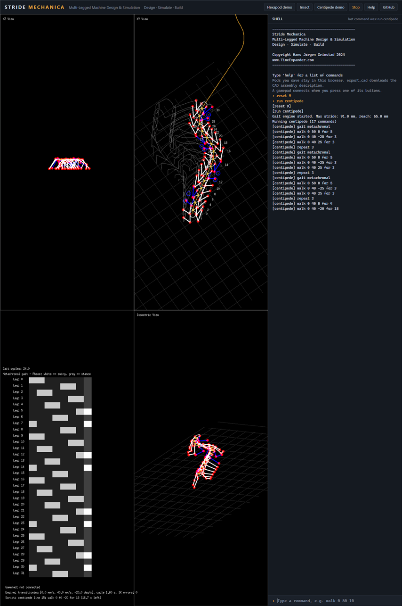

# The browser version

The simulator also runs in a web browser, compiled to WebAssembly. It is the same simulator: the same gait engine,
views, shell commands, example pods and scripts. The views fill the left 2/3 of the page and the shell the right 1/3,
as on the desktop.

Published version: [hansj66.github.io/stride-mechanica](https://hansj66.github.io/stride-mechanica/)



*The centipede demo (the "Centipede demo" button: `reset 9`, `run centipede`) in Chrome.*

## Using it

* Type commands in the shell on the right, as in the terminal. Up and down go through the commands typed before.
  `help` lists them all (see [Using the simulator](simulator.md)).
* The buttons at the top run the demos: the hexapod demo script (`reset 2`, `run demo`), the insect walking a curve
  (`reset 8`, `walk 0 40 10`), the centipede demo script (`reset 9`, `run centipede`). **Stop** halts the pod and the
  script, **Help** runs `help`.
* Commands in the address run when the page has loaded, separated by `;`. For example
  [`?run=reset 9;walk 0 40 15`](https://hansj66.github.io/stride-mechanica/?run=reset%209;walk%200%2040%2015) starts
  the centipede walking a curve.
* A gamepad works as on the desktop (see [Gamepad](simulator.md#gamepad)). Browsers only show a gamepad to a page once
  one of its buttons has been pressed.

The page downloads about 19 MB (4.5 MB compressed) the first time.

### What is different from the desktop version

| | Desktop | Browser |
|---|---|---|
| `save` / `load` | Files in the `pods` folder | The browser's local storage: pods stay in that browser, on that computer |
| `run` / `scripts` | The scripts in the `scripts` folder | The scripts that were in the `scripts` folder when it was built |
| `export_cad` | Writes `cad/out/<name>.json` and builds the STEP assembly and STL with CadQuery | Downloads `<name>.json`. Build the STEP assembly from it on a desktop: `python cad/goik_cad.py <name>.json` (see [CAD export](cad-export.md)) |
| `/quit` | Quits | Close the tab |
| Window layout (`-layout`) | Places the views window and the terminal | The page does the layout |

## Running it locally

From the `goik/goik` folder:

```sh
go run ./cmd/web
```

This builds the browser version into the `web` folder and serves it on [localhost:8080](http://localhost:8080)
(`make web` does the same). Opening `web/index.html` as a file doesn't work: browsers only load the simulator from a
web server.

| Command | Does |
|---|---|
| `go run ./cmd/web` | Build, then serve the `web` folder on localhost:8080 |
| `go run ./cmd/web -build` | Only build. The `web` folder can then be put on any web server as it is |
| `go run ./cmd/web -addr :9000` | Serve on another address or port |

The build is `GOOS=js GOARCH=wasm go build -o web/mechanica.wasm .`, plus a copy of the Go runtime's `wasm_exec.js`
(they must come from the same Go version, so `cmd/web` copies it from the Go that builds). Both are left out of git.

## Publishing on GitHub Pages

The workflow [.github/workflows/browser-version.yml](../../.github/workflows/browser-version.yml) builds the browser
version (`go run ./cmd/web -build`) on every push to `main`, and publishes the `web` folder on GitHub Pages. It needs
Pages to be switched on once: in the repository's **Settings > Pages > Build and deployment**, set **Source** to
**GitHub Actions**. The workflow can also be started by hand from the **Actions** tab ("Browser version", "Run
workflow").

## How it works

| File | Does |
|---|---|
| [web/index.html](../web/index.html) | The page: the header with the demo buttons, the views in a frame, and the shell's console |
| [web/game.html](../web/game.html) | The frame with the views: loads `mechanica.wasm` and starts it |
| [main_js.go](../main_js.go) | The browser version's `main`: builds the scripts into the program |
| [simulator/console_js.go](../simulator/console_js.go) | The shell's console in the page (the desktop uses the terminal: [console_terminal.go](../simulator/console_terminal.go)) |
| [simulator/files_js.go](../simulator/files_js.go) | Pods in the browser's local storage (the desktop uses the `pods` folder: [files_desktop.go](../simulator/files_desktop.go)) |
| [simulator/cadOutput_js.go](../simulator/cadOutput_js.go) | `export_cad` downloads the assembly description (the desktop runs CadQuery: [cadOutput_desktop.go](../simulator/cadOutput_desktop.go)) |
| [cmd/web](../cmd/web/main.go) | Builds and serves the browser version |

The `_js.go` files are only built for the browser (Go picks them by their name), and the desktop files have a
`//go:build !js` line. Everything else is shared.

The page and the frame talk through two functions: the page calls `mechanicaCommand(text)` in the frame for each
command, and the simulator calls the page's `mechanicaConsole` (`print`, `status`, `ready`, `download`) for its
output. The views run in a frame because Ebitengine sizes its canvas to the whole window it runs in.
